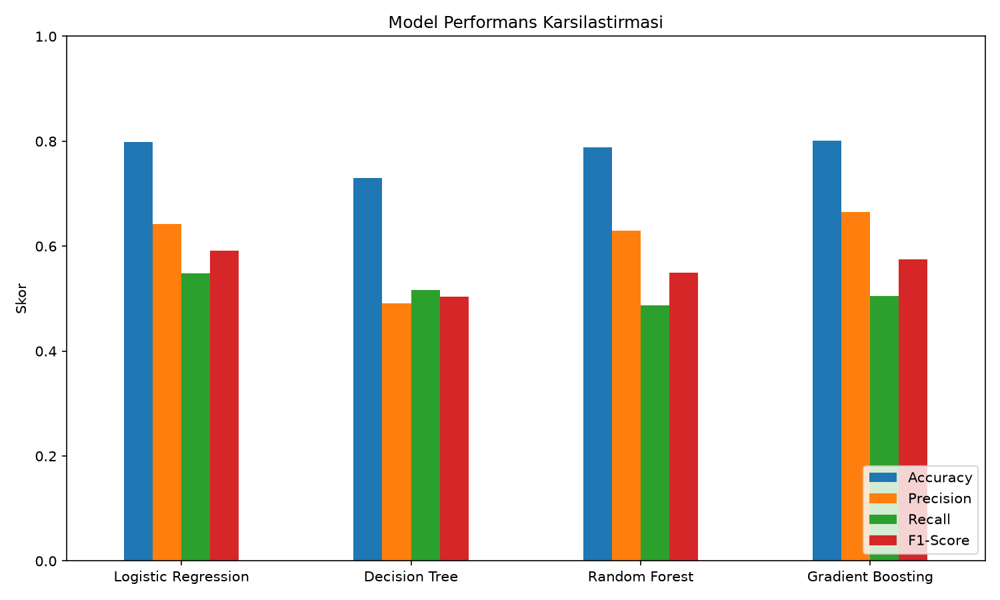
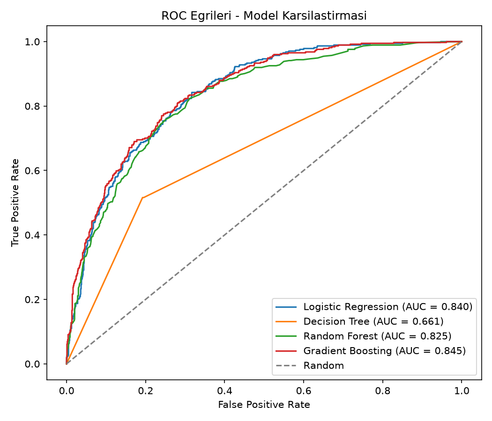
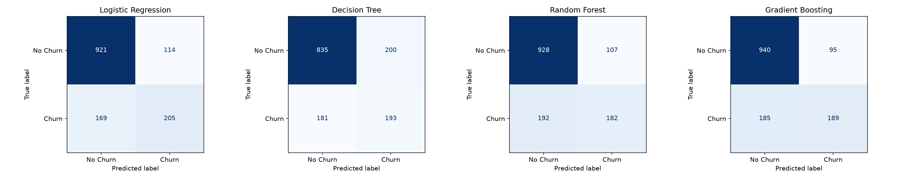

# Customer Churn Prediction with Ensemble Learning

A machine learning project that predicts customer churn using the Telco Customer Churn dataset and compares multiple classification algorithms.

The project demonstrates a complete machine learning workflow including data preprocessing, model training, evaluation, comparison, ROC analysis, confusion matrices, and feature importance visualization.

## Project Objective

Customer churn refers to customers who stop using a company's services.

The objective of this project is to build classification models that can identify customers who are likely to churn and compare the performance of different machine learning algorithms.

## Dataset

The project uses the **Telco Customer Churn** dataset.

The dataset contains customer information such as:

- Demographic information
- Contract type
- Internet and phone services
- Monthly charges
- Total charges
- Customer tenure
- Payment method
- Churn status

Target variable:

`Churn` → Yes / No

## Machine Learning Models

Four classification algorithms are compared:

- Logistic Regression
- Decision Tree
- Random Forest
- Gradient Boosting

Random Forest and Gradient Boosting demonstrate the use of **ensemble learning** techniques.

## Technologies

- Python
- Pandas
- NumPy
- Scikit-learn
- Matplotlib
- Seaborn

## Model Evaluation

Models are evaluated using:

- Accuracy
- Precision
- Recall
- F1-Score
- ROC-AUC
- Confusion Matrix

### Results

| Model | Accuracy | Precision | Recall | F1-Score | ROC-AUC |
|---|---:|---:|---:|---:|---:|
| Logistic Regression | 0.7991 | 0.6426 | 0.5481 | 0.5916 | 0.8403 |
| Decision Tree | 0.7296 | 0.4911 | 0.5160 | 0.5033 | 0.6612 |
| Random Forest | 0.7878 | 0.6298 | 0.4866 | 0.5490 | 0.8247 |
| Gradient Boosting | 0.8013 | 0.6655 | 0.5053 | 0.5745 | 0.8447 |

Logistic Regression achieved the highest F1-Score in this experiment, while Gradient Boosting achieved the highest Accuracy and ROC-AUC.

## Model Performance Comparison



## ROC Curve Comparison



## Confusion Matrices



## Feature Importance

Feature importance visualizations are generated for tree-based models:

- Decision Tree
- Random Forest
- Gradient Boosting

These visualizations help identify which customer characteristics have the greatest influence on the model predictions.

## Project Structure

```text
Customer-Churn-Ensemble-ML/
│
├── data/
│   └── WA_Fn-UseC_-Telco-Customer-Churn.csv
│
├── outputs/
│   ├── confusion_matrices.png
│   ├── feature_importance_decision_tree.png
│   ├── feature_importance_gradient_boosting.png
│   ├── feature_importance_random_forest.png
│   ├── metrics_comparison.png
│   ├── model_metrics.csv
│   └── roc_curves.png
│
├── preprocessing.py
├── train_and_compare.py
├── requirements.txt
└── README.md
```

## Installation

Clone the repository and install the required dependencies:

```bash
pip install -r requirements.txt
```

## Usage

Run the model training and comparison pipeline:

```bash
python train_and_compare.py
```

The script preprocesses the dataset, trains the classification models, calculates evaluation metrics, and generates the visualizations inside the `outputs` directory.

## Key Concepts Demonstrated

- Data preprocessing
- Categorical feature encoding
- Train/test splitting
- Classification
- Ensemble learning
- Model evaluation
- ROC-AUC analysis
- Confusion matrices
- Feature importance
- Data visualization

## Author

**Zeynep Erkoç**

Computer Engineering